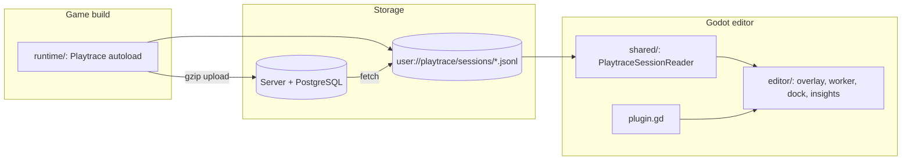
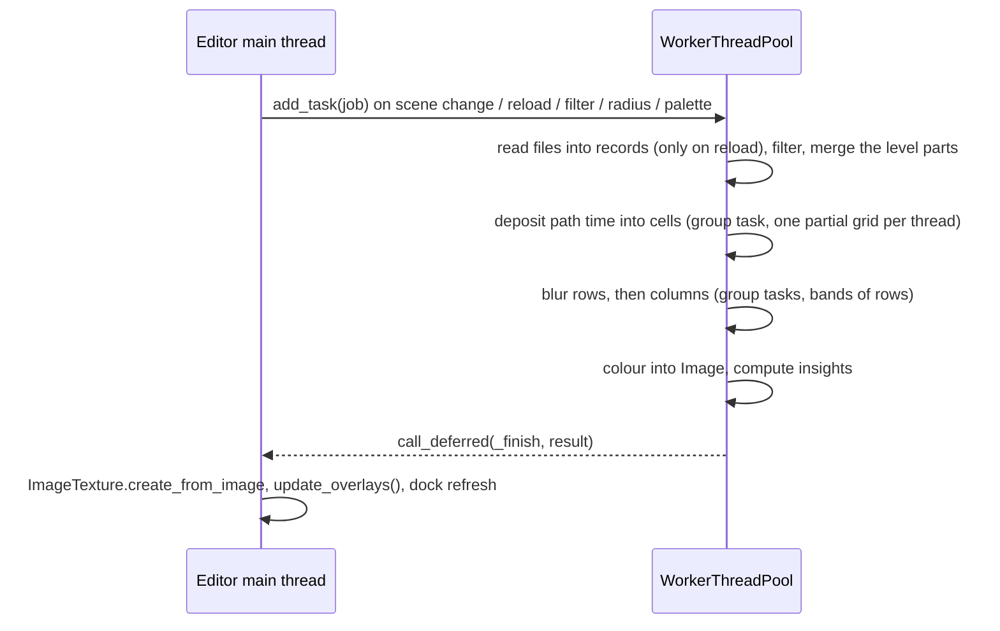

# Architecture

Playtrace has three parts that live in one Godot addon, plus an optional server:

## The runtime / editor / shared boundary

| Folder | Runs in | May use editor classes? | Why |
| --- | --- | --- | --- |
| `addons/playtrace/runtime/` | the game, including exported builds | no | `EditorInterface`, `EditorPlugin` and friends do not exist in exported games; one reference would break every export. |
| `addons/playtrace/shared/` | both game and editor | no | Same reason: the runtime uses it too. Holds the schema constants, settings keys and the session reader, so writer and reader can never disagree. |
| `addons/playtrace/editor/` and `plugin.gd` | the editor only | yes | Everything that draws over the viewport or touches editor UI. |

The editor depends on `shared/`, never on `runtime/` code. The editor's pure-math classes (density grid, palette, transform, level data) do not need the editor either, which is what lets the tests run them headless.

## Editor components

| Component | File | Responsibility |
| --- | --- | --- |
| Plugin entry | [`plugin.gd`](../addons/playtrace/plugin.gd) | Registers the `Playtrace` autoload on enable. While loaded: creates the overlay, the dock and the toolbar switch, follows `scene_changed`, draws the overlay on every viewport redraw, turns clicks on markers into a popover, reloads sessions when a playtest ends, and redraws every frame only while stuck rings pulse on screen. |
| Editor settings | [`editor_config.gd`](../addons/playtrace/editor/editor_config.gd) | Layer, filter, dock and wizard settings in `res://.playtrace/settings.cfg` (git-ignorable, never exported). |
| Session library | [`session_library.gd`](../addons/playtrace/editor/session_library.gd) | Reads session files once (via `PlaytraceSessionReader`) into small records: the list row, the session's part in the open level, and setup-health facts. Filters (level, build, outcome, date range) and merges records without re-reading files. |
| Level data | [`level_data.gd`](../addons/playtrace/editor/level_data.gd) | What was played in one level: movement as paths (broken at deaths, level changes and teleports) split into travel and stay time, plus deaths, stuck events and quits with their session index. |
| Density grid | [`density_grid.gd`](../addons/playtrace/editor/density_grid.gd) | Time-weighted Gaussian density: deposits along paths (stretched in C++), parallel splatting, separable blur, 99th-percentile normalisation. See [HOW_IT_WORKS.md](HOW_IT_WORKS.md#2-the-movement-heatmap-density-grid). |
| Palette | [`heatmap_palette.gd`](../addons/playtrace/editor/heatmap_palette.gd) | Magma and viridis ramps; turns a grid into an RGBA `Image`. |
| Overlay transform | [`overlay_transform.gd`](../addons/playtrace/editor/overlay_transform.gd) | World → overlay pixel mapping with the editor's canvas transform. |
| Marker clusters | [`marker_clusters.gd`](../addons/playtrace/editor/marker_clusters.gd) | Groups nearby markers into numbered badges per zoom level. |
| Insights | [`insights.gd`](../addons/playtrace/editor/insights.gd) | Top death hotspots, largest stuck zone, most common quit point, never-visited floors; average time near a point. |
| Level surfaces | [`level_surfaces.gd`](../addons/playtrace/editor/level_surfaces.gd) | Floors of the edited scene (tops of `StaticBody2D` rectangles and `TileMapLayer` cells) for the never-visited insight. Main thread only. |
| Setup health | [`setup_health.gd`](../addons/playtrace/editor/setup_health.gd) | The D-029 warnings, the health card lines, the manual checklist and the fixes. |
| Heatmap overlay | [`heatmap_overlay.gd`](../addons/playtrace/editor/heatmap_overlay.gd) | The model the dock edits: layer settings, filter, loaded records, background task scheduling, the texture, insights; draws all layers and answers marker clicks. |
| Overlay export | [`overlay_export.gd`](../addons/playtrace/editor/overlay_export.gd) | Renders the level with the layers offscreen (Save PNG, docs screenshots). |
| Dock | [`dock.gd`](../addons/playtrace/editor/dock.gd) | The bottom panel: Sessions, Layers, Insights, Setup and Server tabs, built from plain editor controls. |
| Toolbar | [`heatmap_toolbar.gd`](../addons/playtrace/editor/heatmap_toolbar.gd) | The on/off switch and session count in the 2D toolbar. |

## Data flow and threading

Rules that keep the editor responsive and safe:

- **The main thread never does heavy work.** Reading files, the density grid and colouring all run in one `WorkerThreadPool` task. The main thread only uploads the finished image to an `ImageTexture` and redraws.
- **One task at a time.** Changes made while a task runs (for example dragging the radius slider) only mark the overlay dirty; when the task finishes, one follow-up task runs with the latest settings. So dragging a slider never queues dozens of jobs.
- **Stale results are dropped.** A result for a different level than the one now open is ignored.
- **Inner parallelism.** The density grid splits its own work with `add_group_task` (high priority, since the outer task waits on it). Each piece writes only to arrays it owns, then the main task joins them.
- **Clean shutdown.** When the plugin is removed it waits for the running task, so no thread touches freed objects.
- **Cached records.** The session records are kept after loading, so changing a filter, the radius or the palette re-runs only the merge, grid, colouring and insights, not the file reading. Events are dropped after loading; a record keeps only packed arrays for its part in the open level.
- **Scene access stays on the main thread.** The floors for never-visited insights are read from the edited scene on the main thread and passed to the task as plain rects.

## Drawing

The overlay is drawn in `_forward_canvas_force_draw_over_viewport()`, enabled with `set_force_draw_over_forwarding_enabled()`. The plain `_forward_canvas_draw_over_viewport()` named in the spec is only called while the plugin handles the selected node, so the overlay would vanish when you select a normal node. The force variant is called for every redraw. The layers are drawn into two canvas items of Playtrace's own under the editor's overlay control (heatmap below, markers above), so their texture filter does not touch the editor's own drawing. Marker clicks come from the overlay control's `gui_input` signal; the editor still handles the click too (it may select a node under the cursor). See [HOW_IT_WORKS.md](HOW_IT_WORKS.md#4-drawing-over-the-level) for how the layers follow pan and zoom.

## Tests for the editor part

| Test | Suite | Checks |
| --- | --- | --- |
| T16 | `tests/editor/density_grid_test.gd` | peak cell, total mass, Gaussian shape, empty input, colours |
| T17, T18, T19 | `tests/editor/planted_test.gd` | death hotspot on the planted cluster (seeds 1–20), unvisited area stays cold, golden image `tests/golden/heatmap_seed1_magma.png` |
| T20 | `tests/editor/overlay_transform_test.gd` | world → overlay at zoom 0.25 / 1 / 4 and after pan, death marks |
| T21 | `tests/editor/heatmap_perf_test.gd` | 3 million samples computed off the main thread in under 1 s |
| T22 | `tests/editor/session_filter_test.gd` | each Sessions filter returns exactly the expected fixture sessions |
| T23 | `tests/editor/insights_test.gd` | fixed seed: top hotspot, stuck zone, quit point and the hidden room's floor match `tools/planted.json` |
| T24 | `tests/editor/marker_clusters_test.gd` | badge counts add up to the number of markers at every zoom; groups split when zoomed in |
| T25 | `tests/editor/editor_config_test.gd` | settings survive a save and a fresh load |
| T26 | `tests/editor/setup_health_test.gd` | each `setup_health` fixture triggers its warning once; the main fixtures trigger none |
| — | `tests/editor/level_data_test.gd` | level filtering and path breaks with the frozen fixtures |

To regenerate the golden image after an intended visual change, run the suite with `PLAYTRACE_UPDATE_GOLDEN=1` and commit the new PNG. The M3 overlay pictures come from `tests/golden/render_m3_overlay.gd` (needs a GPU, not `--headless`); the M4 pictures (`docs/images/m4_*.png`) are screenshots of the real editor with 200 generated sessions (seed 1).

Design decisions are logged in [DECISIONS.md](DECISIONS.md).
