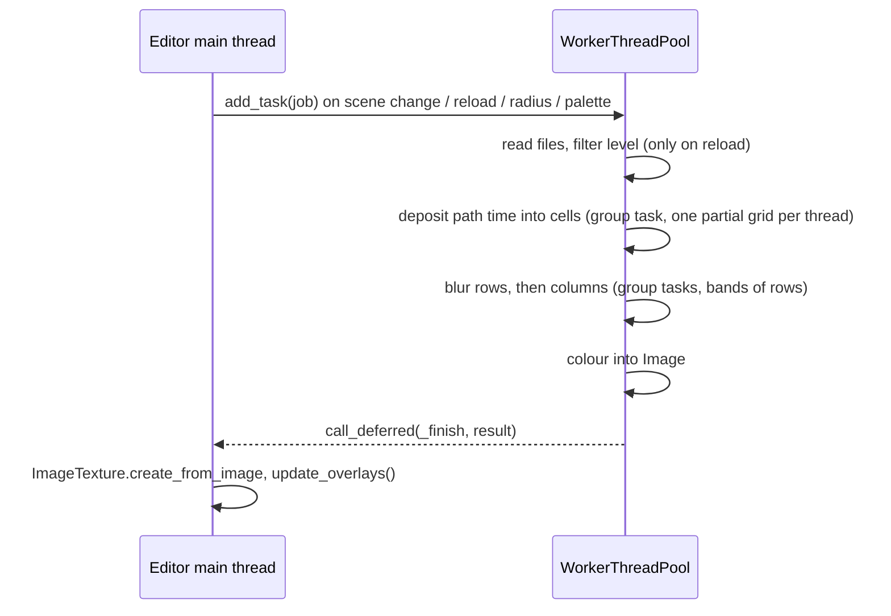

# Architecture

Playtrace has three parts that live in one Godot addon, plus an optional server:

## The runtime / editor / shared boundary

| Folder | Runs in | May use editor classes? | Why |
| --- | --- | --- | --- |
| `addons/playtrace/runtime/` | the game, including exported builds | no | `EditorInterface`, `EditorPlugin` and friends do not exist in exported games; one reference would break every export. |
| `addons/playtrace/shared/` | both game and editor | no | Same reason: the runtime uses it too. Holds the schema constants, settings keys and the session reader, so writer and reader can never disagree. |
| `addons/playtrace/editor/` and `plugin.gd` | the editor only | yes | Everything that draws over the viewport or touches editor UI. |

The editor depends on `shared/`, never on `runtime/` code. The editor's pure-math classes (density grid, palette, transform, level data) do not need the editor either, which is what lets the tests run them headless.

## Editor components

| Component | File | Responsibility |
| --- | --- | --- |
| Plugin entry | [`plugin.gd`](../addons/playtrace/plugin.gd) | Registers the `Playtrace` autoload on enable. While loaded: creates the overlay and toolbar, follows `scene_changed`, and calls the overlay on every viewport redraw. |
| Level data | [`level_data.gd`](../addons/playtrace/editor/level_data.gd) | Reads session files (via `PlaytraceSessionReader`) and keeps what was played in one level: movement as paths (broken at deaths, level changes and teleports) split into travel and stay time, plus deaths. |
| Density grid | [`density_grid.gd`](../addons/playtrace/editor/density_grid.gd) | Time-weighted Gaussian density: deposits along paths (stretched in C++), parallel splatting, separable blur, 99th-percentile normalisation. See [HOW_IT_WORKS.md](HOW_IT_WORKS.md#2-the-movement-heatmap-density-grid). |
| Palette | [`heatmap_palette.gd`](../addons/playtrace/editor/heatmap_palette.gd) | Magma and viridis ramps; turns a grid into an RGBA `Image`. |
| Overlay transform | [`overlay_transform.gd`](../addons/playtrace/editor/overlay_transform.gd) | World → overlay pixel mapping with the editor's canvas transform. |
| Heatmap overlay | [`heatmap_overlay.gd`](../addons/playtrace/editor/heatmap_overlay.gd) | Layer settings (opacity, palette, radius), background task scheduling, the finished texture, and the drawing code. |
| Toolbar | [`heatmap_toolbar.gd`](../addons/playtrace/editor/heatmap_toolbar.gd) | Minimal M3 controls in the 2D toolbar; replaced by the dock's Layers tab in M4. |

## Data flow and threading

Rules that keep the editor responsive and safe:

- **The main thread never does heavy work.** Reading files, the density grid and colouring all run in one `WorkerThreadPool` task. The main thread only uploads the finished image to an `ImageTexture` and redraws.
- **One task at a time.** Changes made while a task runs (for example dragging the radius slider) only mark the overlay dirty; when the task finishes, one follow-up task runs with the latest settings. So dragging a slider never queues dozens of jobs.
- **Stale results are dropped.** A result for a different level than the one now open is ignored.
- **Inner parallelism.** The density grid splits its own work with `add_group_task` (high priority, since the outer task waits on it). Each piece writes only to arrays it owns, then the main task joins them.
- **Clean shutdown.** When the plugin is removed it waits for the running task, so no thread touches freed objects.
- **Cached samples.** The samples of the open level are kept after loading, so changing the radius or palette re-runs only the grid and colouring, not the file reading.

## Drawing

The overlay is drawn in `_forward_canvas_force_draw_over_viewport()`, enabled with `set_force_draw_over_forwarding_enabled()`. The plain `_forward_canvas_draw_over_viewport()` named in the spec is only called while the plugin handles the selected node, so the overlay would vanish when you select a normal node. The force variant is called for every redraw. See [HOW_IT_WORKS.md](HOW_IT_WORKS.md#4-drawing-over-the-level) for how the layers follow pan and zoom.

## Tests for the editor part

| Test | Suite | Checks |
| --- | --- | --- |
| T16 | `tests/editor/density_grid_test.gd` | peak cell, total mass, Gaussian shape, empty input, colours |
| T17, T18, T19 | `tests/editor/planted_test.gd` | death hotspot on the planted cluster (seeds 1–20), unvisited area stays cold, golden image `tests/golden/heatmap_seed1_magma.png` |
| T20 | `tests/editor/overlay_transform_test.gd` | world → overlay at zoom 0.25 / 1 / 4 and after pan, death marks |
| T21 | `tests/editor/heatmap_perf_test.gd` | 3 million samples computed off the main thread in under 1 s |
| — | `tests/editor/level_data_test.gd` | level filtering with the frozen fixtures |

To regenerate the golden image after an intended visual change, run the suite with `PLAYTRACE_UPDATE_GOLDEN=1` and commit the new PNG. The docs screenshots come from `tests/golden/render_m3_overlay.gd` (needs a GPU, not `--headless`).

Design decisions are logged in [DECISIONS.md](DECISIONS.md).
