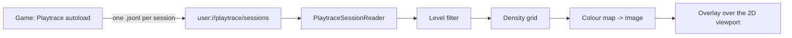
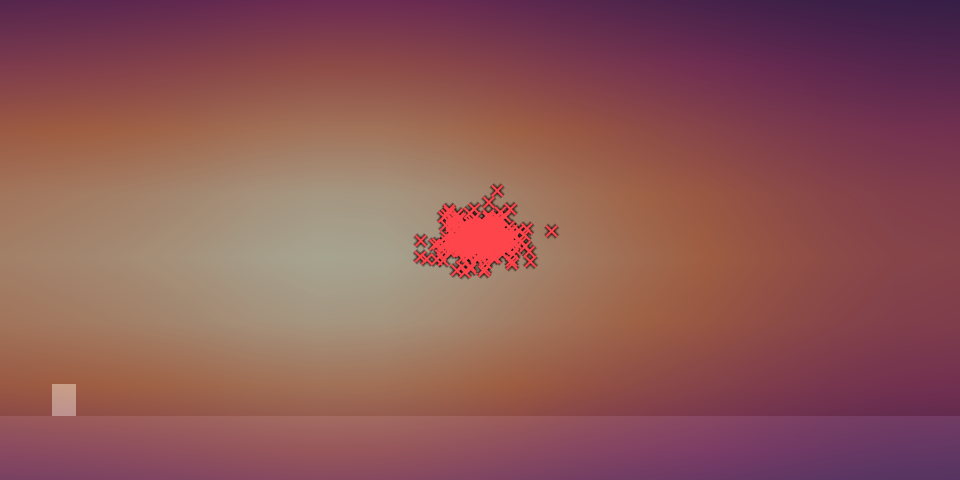
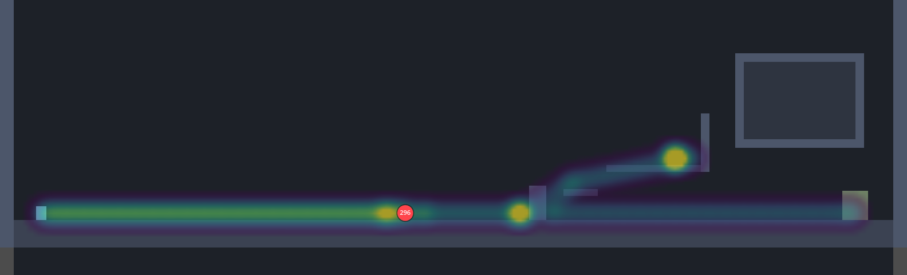
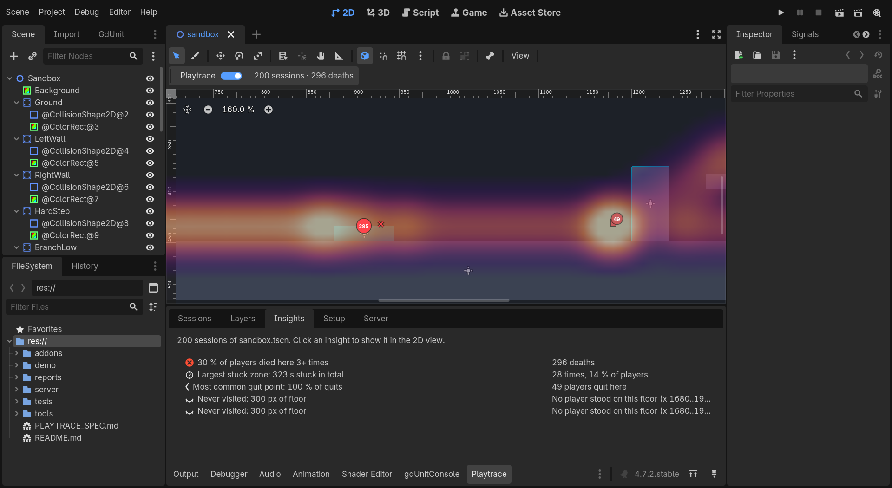

# How Playtrace works

Playtrace records where playtesters go, die, get stuck and quit, and draws that over the level in the Godot editor:



The recording, file format and upload parts are described by the lead in later milestones. The session format is in [CONTRACTS.md](CONTRACTS.md). This page explains the editor side: from session files to the picture over your level.


## 1. Which sessions are shown

When you open a scene in the 2D editor, Playtrace takes the scene's `scene_file_path` (for example `res://demo/sandbox.tscn`) and reads every session file in `user://playtrace/sessions`.

A session can visit several levels. Only the part played in the open scene counts: events between a `level_enter` for that scene and the next `level_enter` or `level_exit`. A session that never entered the scene adds nothing. Files are read with the shared `PlaytraceSessionReader`, so corrupt lines are skipped with one warning per file.

From that part Playtrace keeps:

- **paths**: runs of `pos` samples (`p` and `t`) that belong together;
- **deaths**: the `p` of every `death` event.

### Paths and where they break

Consecutive `pos` samples are joined into a path, as line segments. A path is **broken** (the two sides are never joined) at:

- a `death` (the player respawns somewhere else),
- a `level_enter` or `level_exit`,
- any step faster than **1500 px/s** (a teleport: a door, a checkpoint warp, a scripted move).

`death`, `stuck`, `quit` and other events are not points of the path. Their times still matter, see below.

Code: [`level_data.gd`](../addons/playtrace/editor/level_data.gd).

## 2. The movement heatmap (density grid)

The heatmap shows **where players spent their time**. Every second a player spent somewhere adds a small soft "bump" of mass 1 around that place; where much time piles up, the bumps add up to a hot spot.

### Turning samples into time

The recorder writes a `pos` only when the player moved more than 2 px since the last one, every 0.2 s (contract section 5). So a long gap between two samples means the player stood still. For two consecutive samples `a → b` of a path, with `dt = t_b − t_a` seconds:

- up to **0.2 s** of `dt` is **travel**, spread evenly along the segment from `a` to `b`;
- the rest, `dt − 0.2 s`, is a **stay** at `a`: the player waited there before moving on;
- the last sample of a path stays until the event that ended the path (a death, a level change, the jump of a teleport), or, if the session just ends, until the session's last event in the level. That is how the hesitation before a `quit` shows up.

So each path adds exactly its duration, and the whole map adds up to the recorded time in seconds (test T16 checks this to 0.1 %). Standing still, getting stuck and hesitating before quitting are all visible, which counting samples would miss.

### The density formula

The bump is a Gaussian kernel. The density at a point `c` of the level is

```text
D(c) = Σ over stays (q, s)        s · G(c − q)
     + Σ over segments a → b      ∫ from 0 to 1  m · G(c − (a + u·(b − a))) du

G(d) = exp( −|d|² / (2σ²) ) / Z
```

- `s` is the seconds of a stay at `q`; `m = min(dt, 0.2 s)` is the travel time of a segment, spread uniformly along it.
- `σ` (sigma) is the **kernel radius** slider, in world pixels (default 16). Bigger σ gives a smoother, blurrier map; smaller σ keeps paths narrow and bleeds less into walls and floors.
- `Z` scales the kernel so it adds up to exactly 1, so mass is preserved.

The death layer uses the same machinery with plain points: each death adds mass 1.

### Computing it fast

Adding a 2D bump per sample would cost `samples × kernel cells`, which is far too slow for millions of samples in GDScript. Playtrace works on a grid of square cells (σ / 2 wide) in three steps:

1. **Deposits along each path.** The integral along a segment is approximated by `k` equal deposits at the middles of `k` equal pieces, at most 1.5σ apart. Gaussians 1.5σ apart sum to a ridge that is flat to about 0.03 %, so paths look continuous with no beads. Subdividing segments one by one in GDScript is slow (~1.5 µs each), so a whole path is stretched in C++: it is stored as a one-row floating-point `Image` and resized with bilinear filtering, which returns exactly those points.
2. **Splatting into cells.** Each deposit is shared between the two nearest cell centres along the path's main axis, in proportion to distance. Plain nearest-cell binning would snap deposits that sit a fixed distance apart into a repeating pattern, which shows as bright and dark stripes along busy paths. Across the path, rounding only shifts it by under half a cell. Sessions are split over worker threads; each thread fills its own grid and the grids are summed in parallel.
3. **Separable blur.** The 2D Gaussian equals a 1D Gaussian along x times a 1D Gaussian along y. So blurring along every row, then along every column, gives exactly the same result as the 2D kernel, but costs only `cells × 13` operations. Both passes skip empty cells (most of a level is empty) and run in bands of rows on worker threads.

Details that keep the result correct:

- The 1D kernel is always 13 taps (±3σ) whatever the slider says. Large levels get bigger cells so the grid never exceeds about a million cells.
- The grid covers all samples plus 3σ and one cell on every side, so no bump is cut off at the edge and no mass is lost.
- Every thread writes only to arrays it owns. Packed arrays in GDScript are copy-on-write, so two threads writing into one shared array is not safe.

Performance: 1,000 sessions × 10 minutes of constant running at 220 px/s (3 million samples) are computed in about 0.8 s on an 8-thread desktop, inside the 1 s budget (test T21).

Code: [`density_grid.gd`](../addons/playtrace/editor/density_grid.gd).

## 3. From numbers to colours

The grid values are turned into an image with a colour ramp (`Gradient`):

- **Magma** (default): transparent → indigo → magenta → orange → warm white.
- **Viridis**: transparent → purple → blue → green → yellow (colour-blind friendly).

Each cell's value is divided by the **99th percentile** of the non-empty cells, clamped at 1, and raised to the power 0.5 before the lookup. Dividing by the maximum instead would let one very hot spot (a place where many players stood for a long time) turn every normal path nearly invisible. With the percentile, the top 1 % of cells all show the hottest colour, and the curve keeps quiet paths visible. A logarithmic curve was tried as well: busy and quiet paths looked more alike and the glow around paths grew wider, so the square root stays.

The lowest values are fully transparent, and even the hottest colour is only 95 % opaque. The image is drawn at the opacity slider's value (default 65 %), so the level always stays readable.

The image has one pixel per cell, plus mipmaps. It is drawn with **linear filtering**, so the GPU blends neighbouring cells smoothly; because the data is already smooth (cells are σ / 2), no grid cells are visible even at 400 % zoom. The mipmaps keep the map from shimmering when you zoom out:



Empty cells get the first ramp colour with alpha 0, not black, so filtering does not leave a dark fringe at the edges.

The same data with the viridis palette:



Code: [`heatmap_palette.gd`](../addons/playtrace/editor/heatmap_palette.gd).

## 4. Drawing over the level

The 2D editor shows your scene through a canvas transform: it scales by the zoom and moves by the pan. The editor draws its own gizmos with that same transform on an overlay control above the scene. Playtrace hooks into that overlay (`EditorPlugin._forward_canvas_force_draw_over_viewport`, D-027) and on every redraw:

1. reads the current transform from `EditorInterface.get_editor_viewport_2d().global_canvas_transform`;
2. draws the heatmap texture over the world rectangle the grid covers, using that transform, so it scales and moves with the level;
3. maps every marker position through the transform and draws it at a fixed screen size, so markers stay readable at any zoom.

The layers go into two canvas items of Playtrace's own, placed under the editor's overlay control: first the heatmap (with linear filtering and mipmaps), then the markers. That way the texture filter never changes how the editor draws its own icons.

Because nothing is cached in screen space, the layers stay exactly on the level while you pan and zoom (test T20).

### Markers

| Layer | Drawn as |
| --- | --- |
| Deaths | A red X with a soft dark outline (two wide translucent dark strokes under the red one), so it reads on light and dark tiles. |
| Stuck zones | A soft yellow ring that pulses gently. Its radius grows with the total seconds players were stuck there (1.5 px per second, 10 to 60 px). The plugin redraws every frame only while rings are on screen in the 2D view. |
| Quit points | A small muted red door with a dark outline. |

Code: [`heatmap_overlay.gd`](../addons/playtrace/editor/heatmap_overlay.gd), [`overlay_transform.gd`](../addons/playtrace/editor/overlay_transform.gd).

### Clustering into numbered badges

When you zoom out, many markers land on the same few pixels. Playtrace groups them into one badge with the number of markers inside:

1. Markers are put into square cells 18 screen pixels wide. In world pixels that is `18 / zoom`, so cells grow as you zoom out and shrink as you zoom in.
2. Neighbouring cells whose marker centres are closer than one cell are joined, so a group sitting on a cell border is not split in two.
3. Each group becomes one marker at the average position of its members. A group of one is drawn as a normal marker; bigger groups get a badge.

Every marker ends up in exactly one group, so the badge numbers always add up to the number of markers (test T24). The work is linear in the number of markers and is cached per zoom level.



Code: [`marker_clusters.gd`](../addons/playtrace/editor/marker_clusters.gd).

## 5. Insights: how hotspots are ranked

The **Insights** tab lists, for the open level and the sessions that pass the filters:

- **Top 3 death hotspots.** Deaths are grouped like the badges, with a fixed 48 px world distance, and ranked by the number of deaths. For each hotspot Playtrace counts deaths per session: the share of players who died there at all, and the share who died there 3 or more times. The second is shown ("30 % of players died here 3+ times") when at least 10 % of players did; otherwise the first.
- **Largest stuck zone.** Stuck events grouped the same way, ranked by total stuck seconds.
- **Most common quit point.** Quit events grouped the same way, ranked by count, shown as a share of all quits.
- **Never-visited floors.** Playtrace reads the level's solid shapes (`StaticBody2D` rectangles and `TileMapLayer` cells) and takes their top edges as floors a player could stand on. Along each floor it samples the movement heatmap 16 px above it (where a standing player's centre is). Stretches of at least 64 px where the density stays under 1 % of the colour scale are listed, longest first. Other shapes (polygons, circles, rotated bodies) are not checked.

Clicking an insight centres the 2D view on it. The popover on a marker shows its count, the share of players, and the **average time spent** nearby: the heatmap's mass (seconds) within 48 px, divided by the number of players.

Test T23 checks that, for a fixed generator seed, the top hotspot, the stuck zone, the quit point and the hidden room's floor match `tools/planted.json`.

Code: [`insights.gd`](../addons/playtrace/editor/insights.gd), [`level_surfaces.gd`](../addons/playtrace/editor/level_surfaces.gd).

## 6. Setup health

The **Setup** tab checks the recording setup from the sessions themselves (spec 2.3, D-029):

- `player_not_found`: a session header says no player was found (`detection.player` is empty).
- `player_never_moved`: a player was found, but every `pos` of a session is within 2 px of its first one, so the wrong node is probably tracked.
- `reloads_without_deaths`: some level was re-entered 3 or more times in total across sessions (a `level_enter` for a level the session had already entered) and has no deaths. The game probably "kills" the player without removing the node.

Each warning is listed once. The card shows the detection of the latest session (mode, player, deaths, levels) in green when the sessions confirm it and yellow when it is only guessed or looks wrong, with a **Fix** button that shows the exact line of code and where to put it.

Code: [`setup_health.gd`](../addons/playtrace/editor/setup_health.gd).
