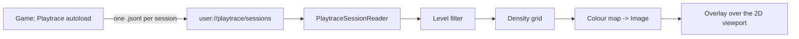
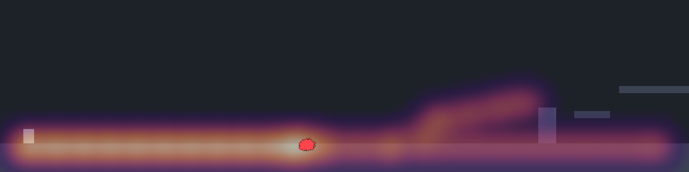

# How Playtrace works

Playtrace records where playtesters go, die, get stuck and quit, and draws that over the level in the Godot editor:



The recording, file format and upload parts are described by the lead in later milestones. The session format is in [CONTRACTS.md](CONTRACTS.md). This page explains the editor side: from session files to the picture over your level.



## 1. Which sessions are shown

When you open a scene in the 2D editor, Playtrace takes the scene's `scene_file_path` (for example `res://demo/sandbox.tscn`) and reads every session file in `user://playtrace/sessions`.

A session can visit several levels. Only the part played in the open scene counts: events between a `level_enter` for that scene and the next `level_enter` or `level_exit`. A session that never entered the scene adds nothing. Files are read with the shared `PlaytraceSessionReader`, so corrupt lines are skipped with one warning per file.

From that part Playtrace keeps two lists:

- **movement samples**: the `p` of every `pos` event (one every 0.2 s while the player moves), one list per session;
- **deaths**: the `p` of every `death` event.

Code: [`level_data.gd`](../addons/playtrace/editor/level_data.gd).

## 2. The movement heatmap (density grid)

The heatmap shows where players spent their time. Each movement sample adds a small soft "bump" around its position; where many samples pile up, the bumps add up to a hot spot.

The bump is a Gaussian kernel. The density at a point `c` of the level is

```text
D(c) = Σ over samples p of  G(c − p)

G(d) = exp( −|d|² / (2σ²) ) / Z
```

- `σ` (sigma) is the **kernel radius** slider, in world pixels (default 32). Bigger σ gives a smoother, blurrier map; smaller σ shows narrow paths.
- `Z` scales the kernel so it adds up to exactly 1. So every sample adds exactly 1 to the map, and the whole map adds up to the number of samples (test T16 checks this to 0.1 %).

### Computing it fast

Adding a 2D bump for every sample would cost `samples × kernel cells`, which is far too slow for a million samples in GDScript. Playtrace instead works on a grid of square cells and does it in two cheap steps:

1. **Binning.** Each sample adds 1 to the one cell it falls in. The sessions are split over worker threads; each thread fills its own grid and the grids are summed afterwards. Mapping a whole session to cell coordinates is a single `Transform2D * PackedVector2Array` call, which runs in C++.
2. **Separable blur.** The 2D Gaussian equals a 1D Gaussian along x times a 1D Gaussian along y. So blurring the counts along every row, then along every column, gives exactly the same result as the 2D kernel, but costs only `cells × 13` operations. Both passes skip empty cells (most of a level is empty) and run in bands of rows on worker threads.

Details that keep the result correct:

- The cell size is σ / 2, so the 1D kernel is always 13 taps (±3σ) whatever the slider says. Large levels get bigger cells so the grid never exceeds about a million cells.
- The grid covers all samples plus 3σ and one cell on every side, so no bump is cut off at the edge and no mass is lost.
- Every thread writes only to arrays it owns. Packed arrays in GDScript are copy-on-write, so two threads writing into one shared array is not safe.

Performance: 1,000 sessions × 10 minutes of constant movement (3 million samples) are computed in about 0.3 s on an 8-thread desktop, well inside the 1 s budget (test T21).

Code: [`density_grid.gd`](../addons/playtrace/editor/density_grid.gd).

## 3. From numbers to colours

The grid values are turned into an image with a colour ramp (`Gradient`):

- **Magma** (default): transparent → indigo → magenta → orange → warm white.
- **Viridis**: transparent → purple → blue → green → yellow (colour-blind friendly).

Each cell's value is divided by the hottest cell and raised to the power 0.5 before the lookup. Without that, one very hot spot (like the spawn point, which every session passes) would make every normal path nearly invisible.

The lowest values are fully transparent, and even the hottest colour is only 95 % opaque. The image is drawn at the opacity slider's value (default 65 %), so the level always stays readable.

The image has one pixel per cell. It is drawn with **linear filtering**, so the GPU blends neighbouring cells smoothly; because the data is already smooth (cells are σ / 2), no grid cells are visible even at 400 % zoom:


Empty cells get the first ramp colour with alpha 0, not black, so filtering does not leave a dark fringe at the edges.

Code: [`heatmap_palette.gd`](../addons/playtrace/editor/heatmap_palette.gd).

## 4. Drawing over the level

The 2D editor shows your scene through a canvas transform: it scales by the zoom and moves by the pan. The editor draws its own gizmos with that same transform on an overlay control above the scene. Playtrace hooks into that overlay (`EditorPlugin._forward_canvas_force_draw_over_viewport`) and on every redraw:

1. reads the current transform from `EditorInterface.get_editor_viewport_2d().global_canvas_transform`;
2. draws the heatmap texture over the world rectangle the grid covers, using that transform, so it scales and moves with the level;
3. maps every death position through the transform and draws an X mark there at a fixed screen size (10 px), so marks stay readable at any zoom. Each X is drawn three times: two wide, translucent dark strokes as a soft outline, then the red stroke on top. The outline keeps the marks visible on light and dark tiles.

Because nothing is cached in screen space, the layers stay exactly on the level while you pan and zoom (test T20).

Code: [`heatmap_overlay.gd`](../addons/playtrace/editor/heatmap_overlay.gd), [`overlay_transform.gd`](../addons/playtrace/editor/overlay_transform.gd).

## 5. Controls (M3)

Until the dock arrives (M4), the controls sit in the 2D editor toolbar: show/hide, opacity, kernel radius, palette, reload. Press reload after a new playtest to read the new session files. Opacity only redraws; radius and palette rebuild the image in the background; reload also re-reads the files.
