# User guide

Playtrace shows where playtesters die, get stuck, get lost and quit, drawn over your level in the Godot 2D editor. This guide covers everything you see in the editor. For the API and settings, see [MANUAL_INTEGRATION.md](MANUAL_INTEGRATION.md); for how the numbers are computed, see [HOW_IT_WORKS.md](HOW_IT_WORKS.md).

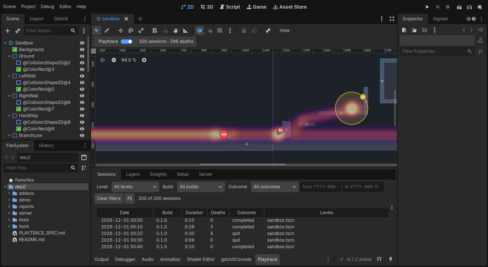

## Installing

1. Copy `addons/playtrace` into your project's `addons/` folder.
2. Open **Project → Project Settings → Plugins** and enable **Playtrace**. This registers the `Playtrace` autoload and the project settings.
3. The **Playtrace** panel opens at the bottom of the editor on its **Setup** tab.

## Plug-and-play or manual

The first time, the Setup tab asks how you want to record:

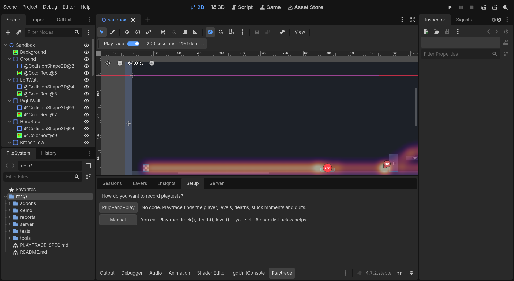

- **Plug-and-play** (recommended): no code. Playtrace finds the player (the first node in group `player`, else the first `CharacterBody2D`), uses each scene as a level, and counts a death when the player node is removed or the scene reloads quickly.
- **Manual**: Playtrace records only what you call. The Setup tab then shows a checklist of calls, each with a copy button and where it goes. An item ticks itself as soon as a recorded session contains its event.

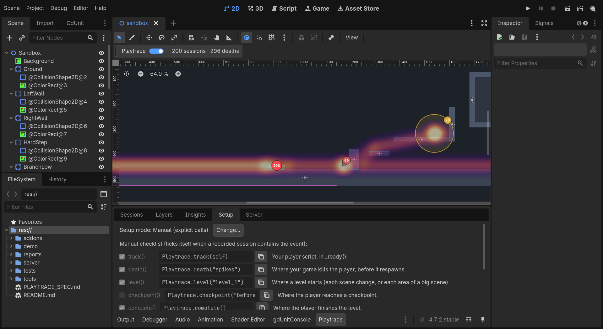

You can mix both: the first explicit call for a feature (for example `Playtrace.death()`) switches off auto-detection of that feature for the rest of the run. Change the mode later with **Change...** on the Setup tab.

## Recording a playtest

Press **F5** (or F6) and play. Each run writes one session file to `user://playtrace/sessions/`. When you stop the game, the editor reads the new file and the layers update by themselves.

## The layers

Open a 2D scene. If sessions were recorded in it, the layers appear on top of the level. They follow pan and zoom exactly.

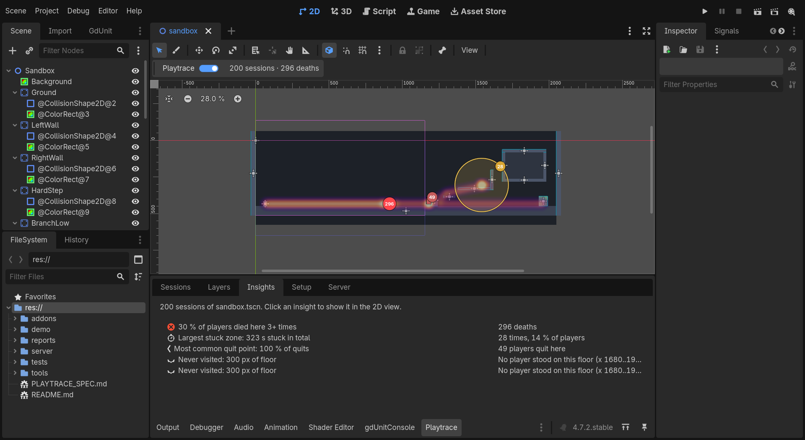

| Layer | What it shows |
| --- | --- |
| **Movement heatmap** | Where players spent their time. Warm white = a lot of time (standing, waiting, getting stuck), magenta/indigo = passing through, nothing = never there. |
| **Deaths** | A red X per death. Zoomed out, nearby deaths merge into a red badge with their count. |
| **Stuck zones** | A soft pulsing yellow ring where players stood still 8 s or more. The bigger the ring, the more seconds in total. A small badge shows how many times. |
| **Quit points** | A muted red door where players quit the game. |

Zoom in and badges split up into single marks:

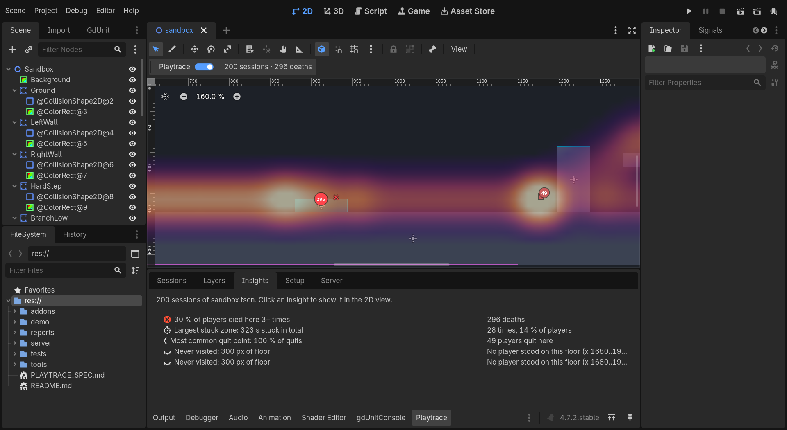

The **Playtrace** switch in the 2D toolbar turns all layers on or off and shows how many sessions and deaths are shown.

### Marker popover

Click a death mark, badge, stuck ring or door to see the details: how many events, the share of players, and the average time a player spent there.

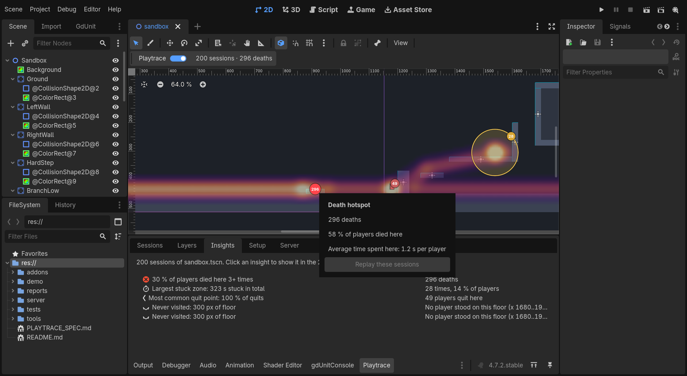

**Replay these sessions** becomes active with path replay (M5).

## The Playtrace panel

### Sessions

Every recorded session: date, build, duration, deaths, outcome (completed, quit or unknown) and levels. Hover a row for its file.

Filters: **Level**, **Build**, **Outcome**, and a date range (`from` / `to`, as `YYYY-MM-DD`, both included). The filters also apply to the layers and insights, so you can compare builds or look only at players who quit. **Clear filters** resets them, the reload button reads the session files again.

### Layers

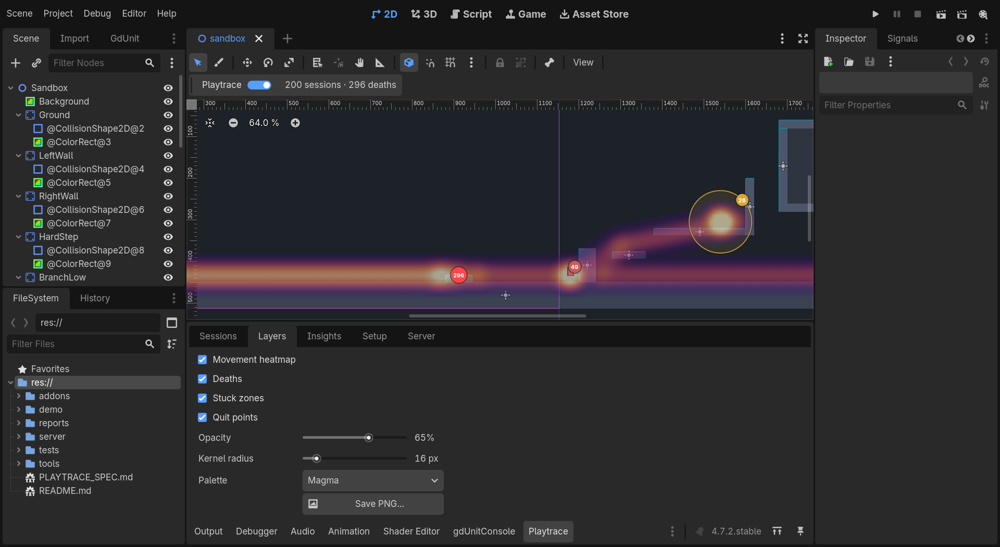

- Check boxes for each layer.
- **Opacity** of the heatmap (default 65 %). Markers always stay fully visible.
- **Kernel radius**: how far each moment spreads (default 16 px). Raise it for small data sets or large levels; lower it to keep paths sharp.
- **Palette**: Magma (default) or Viridis (easier to read for colour-blind people).
- **Save PNG...** exports the level with the current layers as an image, for example to share in a bug report:

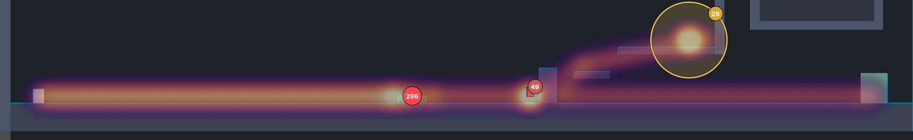

All choices are saved in `res://.playtrace/settings.cfg` and come back when you reopen the project. Add `.playtrace/` to your `.gitignore` if you don't want to share them.

### Insights

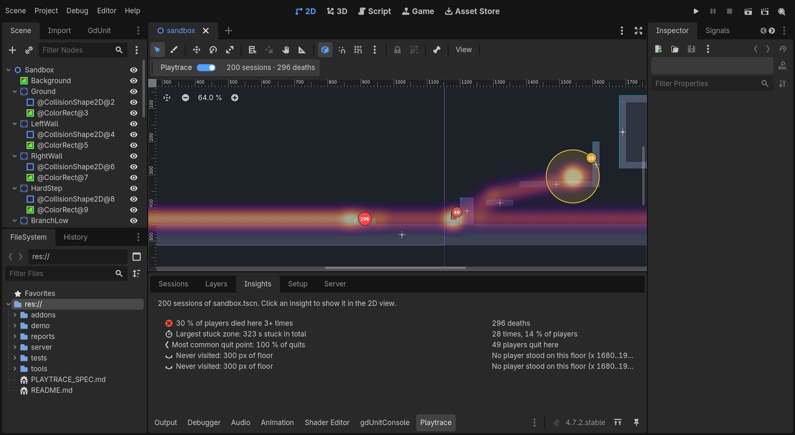

Insights for the open level, for the sessions that pass the filters:

- **Death hotspots** (top 3): for example "30 % of players died here 3+ times". Many repeated deaths at one spot usually means an unfair jump or a hidden hazard.
- **Largest stuck zone**: where players stood still the longest in total. Often an unclear path, a hard jump or a missing hint.
- **Most common quit point**: where players gave up.
- **Never visited**: floors no player stood on. Either a secret nobody found, or a part of the level you could remove.

Click an insight to centre the 2D view on it.

### Setup

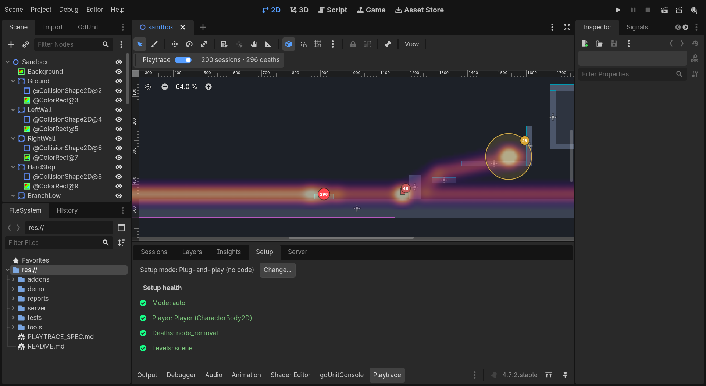

The **Setup health** card shows what Playtrace detected in your latest session: the mode, the player node, how deaths are detected and how levels are named. Green lines are confirmed by the recorded sessions; yellow lines are only guessed or look wrong. A yellow line has a **Fix** button with the exact code and where to put it:

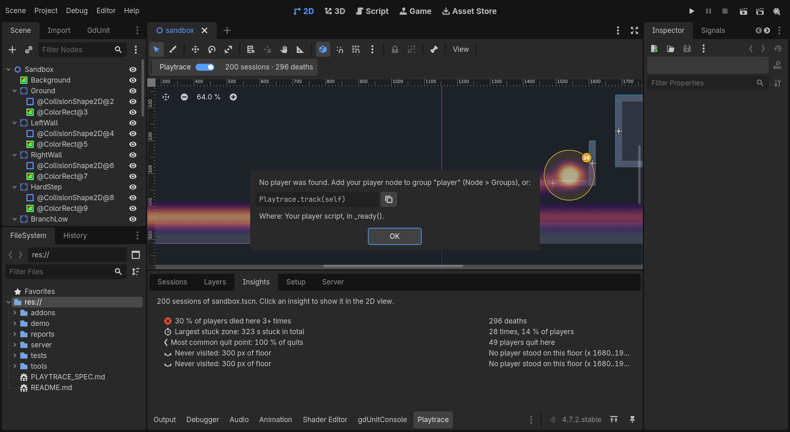

The card also lists these warnings:

| Warning | Meaning |
| --- | --- |
| `player_not_found` | No player node was found. Put your player in group `player`, or call `Playtrace.track(self)` in its `_ready()`. |
| `player_never_moved` | The tracked node never moved, so it's probably the wrong node. |
| `reloads_without_deaths` | Levels restart often but no deaths were recorded. Call `Playtrace.death("cause")` where the player dies. |

### Server

Remote sessions from testers arrive in M6. The tab is a placeholder until then.

## Path replay and in-game feedback

Path replay (M5) and the in-game feedback panel (M7) are not built yet. This guide will cover them when they land.

## Troubleshooting and FAQ

**I see no layers.** Check that the **Playtrace** switch in the 2D toolbar is on, that you are in the **2D** view, and that the open scene is the one you played: Playtrace matches sessions by the scene's file path. Then check the Sessions tab: if it says "No sessions yet", run the game once. If the list has sessions but the layers are empty, a filter may hide them: press **Clear filters**.

**My new playtest doesn't show up.** The panel reloads when the game stops. If you recorded outside the editor (an exported debug build), press the reload button on the Sessions tab.

**The heatmap looks blotchy or too faint.** With only a few sessions, raise the kernel radius. With many, lower it.

**Deaths are missing.** In plug-and-play mode a death is counted when the player node leaves the scene tree, or the scene reloads within 1 s. If your game respawns the player without either, call `Playtrace.death()` yourself (see the `reloads_without_deaths` warning).

**The player is the wrong node.** Add the right node to group `player`, or call `Playtrace.track(self)` from it.

**A floor is listed as never visited but players do go there.** The check samples 16 px above the floor. Very tall characters or floors made of polygons, circles or rotated bodies are not handled yet.

**Clicking a marker also selects a node.** The editor handles the click as well. Click on empty space near the marker, or press Escape to clear the selection.
